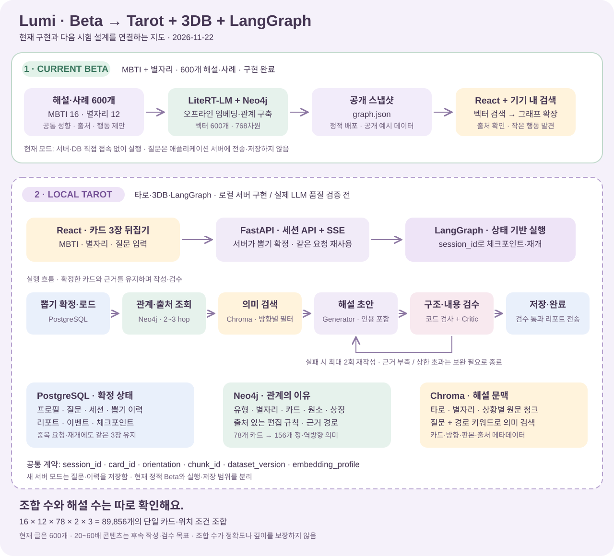

**Serverless · Google LiteRT-LM · On-device Search · Playground**

**Light. Free. Fun.**

# Explore Your Little Universe · Beta

### A fresh perspective on today's little dilemmas.

[한국어](README.md) | **English**

**Current: 600-card GraphRAG Beta** · [Previous version v1](https://github.com/ai-agent-orchestrator/explore-your-little-universe/tree/v1) · [Claude implementation handoff](docs/CLAUDE_TAROT_IMPLEMENTATION.md)

## [Open the playground — no installation](https://ai-agent-orchestrator.github.io/explore-your-little-universe/)

Meet Lumi, try a daily dilemma, and inspect the knowledge graph and source evidence. Use a current Chrome/Edge browser with WebGPU; the first actual search downloads an embedding model.

**[Open the full graph query in your own Neo4j Browser](http://localhost:7474/browser/?cmd=edit&arg=MATCH%20p%20%3D%20%28a%29-%5Br%5D-%3E%28b%29%0AWHERE%20type%28r%29%20IN%20%5B%27HAS_TRAIT%27%2C%27FROM_CHUNK%27%2C%27FROM_DOCUMENT%27%2C%27SUGGESTS%27%2C%27DESCRIBED_BY%27%5D%0A%20%20AND%20any%28label%20IN%20labels%28a%29%20WHERE%20label%20IN%20%5B%27MbtiType%27%2C%27ZodiacSign%27%2C%27SharedTrait%27%2C%27RagChunk%27%2C%27RagTip%27%5D%29%0A%20%20AND%20any%28label%20IN%20labels%28b%29%20WHERE%20label%20IN%20%5B%27SharedTrait%27%2C%27RagChunk%27%2C%27RagTip%27%2C%27RagDocument%27%5D%29%0ARETURN%20p%0ALIMIT%20500%3B)** · **[First-time setup and graph import](docs/OPEN_IN_NEO4J.md)**

Start your local Neo4j instance and import the public example graph once. The link opens your own localhost and contains no password or another person's database connection.


**An MBTI & Astrology Daily Action Playground**


Meet **Lumi**, a little star companion. Explore everyday dilemmas, discover connected perspectives, and try one small action. MBTI and astrology are playful fictional settings here, not validated predictions or clinical assessments.

## Optional tarot implementation (development branch)

The R0–R6 implementation adds a shared `lumi_core`, 78 cards / 156 meanings, transactional PostgreSQL draws, Neo4j/Chroma retrieval, durable LangGraph validation/resume, authenticated FastAPI/SSE, and a lazy React tarot mode. See the [runbook](docs/TAROT_RUNBOOK.md). The existing static corpus, snapshot, Lumi artwork and Pages workflow are preserved.

Chroma contains 780 chunks: the preserved 600 plus 180 authored tarot texts. Real stores, native embeddings, checkpoints, HTTP and browser flows were tested; **generation and critique were tested with FakeLLM only**. Configure an OpenAI-compatible endpoint to use a real LLM. With no `VITE_TAROT_API_URL`, static builds contain no tarot code or tab.

## Current Beta and planned extension

The existing MBTI/zodiac/shared-trait structure is preserved. The corpus grew from 60 to 600 cards, with source attribution, an interpretation reader, and question-aware graph ranking. The original **“Hi, I'm Lumi.”** illustration remains unchanged.



The upper lane is the existing static Beta. The lower lane is the optional local server implementation, tested with real stores and a FakeLLM; it is not a server hosted by GitHub Pages.

## Static React + browser LiteRT-LM search

The React edition is included in `main`. Changes to `frontend` on `main` are tested, built, and deployed automatically by GitHub Actions.

No Spring server, Python web server, Ollama, database credentials, or paid API is required to run the page. Neo4j is used to build and inspect the graph. The published page reads an exported public snapshot and performs embedding, cosine search, and graph traversal on the visitor's device.

```text
Authoring: original scenario texts → LiteRT-LM embeddings → Neo4j → public snapshot
Browsing: React → on-device question embedding → vector search → graph expansion
```

### Run locally

Use Node.js 22.12+ and a recent Chrome or Edge browser with WebGPU enabled.

```powershell
git fetch origin
git switch main
cd frontend
npm ci
npm run dev
```

Open the printed address, normally http://127.0.0.1:5173. An explicitly marked example appears immediately. The first real search downloads a pinned public model (~165MB), verifies its SHA-256, and runs it locally. Model caching depends on browser storage availability; startup depends on device memory and WebGPU support.

### Explore

- **600 interpretation and scenario cards:** 60 preserved originals, 160 type interpretations, 120 zodiac interpretations, and 260 new everyday scenarios. Public profile summaries are paraphrased; practical applications are independently authored. See [sources, data composition and validation](docs/INTERPRETATION_CORPUS.md).
- **24 small action suggestions**, each linked to supporting source cards.
- **16 MBTI Lumi outfits** and **12 zodiac Lumi palettes and symbols**.
- **Vector only:** the three most similar scenario texts.
- **Vector + graph:** additional evidence and suggestions reached from those same texts.
- **Evidence view:** source IDs, original text, graph paths, and a Cypher query to inspect the corresponding nodes in Neo4j.
- **Gemini prompt:** copy a source-grounded prompt yourself. Nothing is automatically sent to Gemini.

The browser does not contact Neo4j at runtime. Changes in the authoring DB require re-exporting the snapshot and rebuilding the page. Questions are neither sent to an application server nor stored. Model downloads contact the public model host.

### Build for static hosting

```powershell
cd frontend
npm ci
npm test
npm run build
```

Publish `frontend/dist` on a static host. Relative paths support GitHub Pages project URLs. No `.env` file should be included. Hosting and bandwidth free tiers depend on the provider.

[Full setup, architecture and weekend checks](https://github.com/ai-agent-orchestrator/explore-your-little-universe/blob/main/docs/STATIC_REACT_RAG.md) · [Scenario corpus](https://github.com/ai-agent-orchestrator/explore-your-little-universe/blob/main/mbti_lab/scenarios.py) · [Neo4j seed/export code](https://github.com/ai-agent-orchestrator/explore-your-little-universe/blob/main/mbti_lab/rag_seed.py)

## Planned Tarot + three-database + LangGraph test

Add 78 tarot cards and 156 upright/reversed meanings while preserving the static Beta. PostgreSQL owns confirmed sessions, draws, reports and checkpoints; Neo4j owns source-backed relationships; Chroma retrieves interpretation chunks; LangGraph coordinates retrieval, generation, validation and resume. React flips the three cards confirmed by the server, with FastAPI/SSE carrying session and progress events.

The proposed flow is confirmed draw → graph context → card/direction-filtered retrieval → cited draft → code and LLM validation → saved report. Rewriting is capped at two attempts; missing evidence ends in a needs-evidence state. Resuming never redraws the cards. The new server mode stores questions/history and requires its own backend; the existing static mode continues to search on the device.

`16 × 12 × 78 × 2 × 3 = 89,856` counts single-card/position contexts, not authored documents or complete three-card spreads. Initial authoring targets 780 tarot chunks (1,380 total). Later reviewed-content targets are 14,640–35,700 total, roughly 24–60 times the current corpus, not measured quality improvements.

[Detailed trial design](docs/TAROT_3DB_LANGGRAPH_PLAN.md) · [Implementation-ready Claude handoff](docs/CLAUDE_TAROT_IMPLEMENTATION.md). This section records the original design; use the runbook above for the implemented optional local mode and its tested limits.

## Neo4j lab — MBTI + 12 zodiac signs

The original graph lab remains available:

- [12 zodiac signs + MBTI graph](docs/ASTROLOGY_LAB.md)
- [Original MBTI web lab](mbti_lab/README.md)
- [Three-database collaboration plan](docs/THREE_DB_COLLAB_PLAN.md)

Use Python 3.12 and a dedicated local Neo4j database named `mbti-zodiac`. See [database separation](docs/DATABASE_SEPARATION.md) and the Korean README for setup. Connection settings stay in local, ignored files.

```cypher
MATCH p = (:MbtiType {code:'INTJ'})-[:HAS_TRAIT]->(:SharedTrait)
          <-[:HAS_TRAIT]-(:ZodiacSign {name:'물병자리'})
RETURN p;
```

The fictional content supports graph-learning and entertainment. It is not an official MBTI test, astrology forecast, compatibility score, diagnosis, or treatment recommendation.
