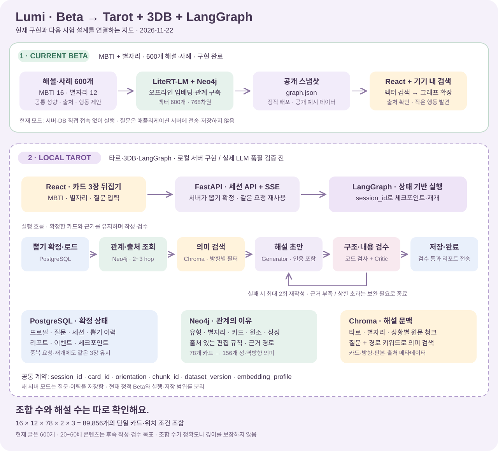

**Serverless · Google LiteRT-LM · On-device Search · Playground**

**Light. Free. Fun.**

# Explore Your Little Universe · Beta

**한국어** | [English](README.en.md)

**현재: 600개 해설·사례 기반 Beta** · [이전 버전 v1](https://github.com/ai-agent-orchestrator/explore-your-little-universe/tree/v1) · [Claude 개발 인계](docs/CLAUDE_TAROT_IMPLEMENTATION.md)

## [바로 놀아보기 · 설치 없이 열기](https://ai-agent-orchestrator.github.io/explore-your-little-universe/)

루미와 이야기하고, MBTI·별자리 그래프와 원문 근거를 함께 살펴보세요. 최신 Chrome·Edge에서 이용하며, 첫 실제 검색에는 임베딩 모델 다운로드가 필요합니다.

**[내 Neo4j Browser에서 전체 그래프 쿼리 열기](http://localhost:7474/browser/?cmd=edit&arg=MATCH%20p%20%3D%20%28a%29-%5Br%5D-%3E%28b%29%0AWHERE%20type%28r%29%20IN%20%5B%27HAS_TRAIT%27%2C%27FROM_CHUNK%27%2C%27FROM_DOCUMENT%27%2C%27SUGGESTS%27%2C%27DESCRIBED_BY%27%5D%0A%20%20AND%20any%28label%20IN%20labels%28a%29%20WHERE%20label%20IN%20%5B%27MbtiType%27%2C%27ZodiacSign%27%2C%27SharedTrait%27%2C%27RagChunk%27%2C%27RagTip%27%5D%29%0A%20%20AND%20any%28label%20IN%20labels%28b%29%20WHERE%20label%20IN%20%5B%27SharedTrait%27%2C%27RagChunk%27%2C%27RagTip%27%2C%27RagDocument%27%5D%29%0ARETURN%20p%0ALIMIT%20500%3B)** · **[처음 사용하는 사람: 데이터 넣는 방법](docs/OPEN_IN_NEO4J.md)**

각자 Neo4j를 시작하고, 최초 한 번 공개 예시 데이터를 넣은 뒤 링크를 사용하세요. 본인의 로컬 Browser를 열며, 비밀번호나 다른 사람의 DB 접속 정보는 포함하지 않습니다.

### 오늘의 작은 고민, 별다른 시선으로.


**An MBTI & Astrology Daily Action Playground**

**A playful daily-action lab inspired by MBTI and astrology.**

*A little insight. One small action.*


React 검색 버전은 `main`에 포함되어 있다. `frontend` 변경을 `main`에 반영하면 GitHub Actions가 검사·빌드 후 공개 사이트에 자동 배포한다. 기존 Neo4j 실습 코드는 아래에서 안내한다.

작은 별 친구 **루미(Lumi)**와 일상 고민을 탐색하는 실습이다. MBTI·별자리라는 정형 그래프와 해설·일상 사례 **600개**를 연결한다. 기존 사례 60개에 유형 해설 160개, 별자리 해설 120개, 추가 일상 사례 260개를 더했다. [데이터 구성·참고 출처·검증](docs/INTERPRETATION_CORPUS.md)에서 확인할 수 있다. 성격을 판정하기보다 관련된 이야기를 찾고 오늘 해볼 작은 행동을 발견한다.

## 현재 Beta와 다음 시험 설계

기존 MBTI·별자리·8개 공통 성향 구조를 유지하면서 검색 대상을 **60개에서 600개로 10배 확장**했다. 유형·별자리별 해설, 출처 링크, 해설을 읽는 화면, 질문과 가까운 그래프 근거를 우선하는 정렬도 함께 추가했다. 이전 공개 버전은 `v1`, 현재 개발 결과는 `main`에 보관한다.



위 그림의 **1번은 현재 구현**, **2번은 다음 단계 설계**다. 기존 **“Hi, I'm Lumi.”** 그림과 정적 검색 흐름은 유지한다.

## 1. 현재 Beta — 정적 React + 브라우저 LiteRT-LM 검색


별도 Spring·Python·Ollama 서버나 API 키 없이 동작한다. **Neo4j는 데이터 구축·검증**, **React와 LiteRT-LM은 브라우저 검색·그래프 확장**을 맡는다. 복잡한 답변이 필요하면 근거 프롬프트를 복사해 Gemini에 직접 가져갈 수 있다.

```text
구축: 상황 글 → LiteRT-LM 임베딩 → Neo4j 벡터·그래프 → 공개 예시 스냅샷
실행: React → 브라우저 LiteRT-LM 질문 임베딩 → 벡터 검색 → 그래프 확장
```

### 바로 갖고 놀기

Node.js 22.12 이상을 준비하고 저장소 루트에서 실행한다. 브라우저 실행에는 Neo4j를 켤 필요가 없다.

```powershell
git fetch origin
git switch main
cd frontend
npm ci
npm run dev
```

표시되는 로컬 주소(기본 http://127.0.0.1:5173)를 WebGPU가 활성화된 최신 Chrome 또는 Edge에서 연다. 처음에는 저장된 질문의 **예제 결과**를 보여준다. 검색 버튼을 누르면 약 165MB의 공개 모델을 다운로드·검증한 뒤 실제 질문을 기기에서 임베딩한다. 브라우저 캐시 공간이 있으면 모델을 재사용한다. 기기 성능과 메모리에 따라 준비 시간이 달라진다.

- **벡터만:** 의미가 가까운 상황 글 3개
- **벡터 + 그래프:** 동일한 검색 결과에서 공통 성향을 따라 다른 글과 행동 제안으로 확장
- **근거 보기:** 원문, 문서 ID, 실제 연결 경로 확인
- **Gemini용 프롬프트:** 원할 때 직접 복사한다. 질문을 자동 전송하지 않는다.

### 정적 배포

```powershell
cd frontend
npm ci
npm run build
```

`frontend/dist`를 정적 호스팅에 올린다. 프로젝트 하위 경로에서도 동작하도록 상대 경로로 빌드한다. 모델은 고정된 Hugging Face 버전에서 다운로드하며 SHA-256을 확인한다. `.env`, DB 접속 정보, API 키를 프론트엔드에 넣지 않는다. 모델과 런타임 다운로드를 제외한 검색은 기기 안에서 수행한다.

실행 중 Neo4j를 직접 조회하는 서비스는 아니다. Neo4j에서 변경한 데이터는 재적재·재내보내기·재빌드해야 반영된다. 현재 콘텐츠는 공개 소개를 짧게 재서술한 해설과 직접 작성한 적용 예시이며, LLM 추출이나 자동 상담 답변은 사용하지 않는다. 외부 호스팅 무료 한도는 서비스마다 다르다.

[구축 코드·모델·주말 검증 안내](https://github.com/ai-agent-orchestrator/explore-your-little-universe/blob/main/docs/STATIC_REACT_RAG.md) · [비정형 상황 카드 원문](https://github.com/ai-agent-orchestrator/explore-your-little-universe/blob/main/mbti_lab/scenarios.py) · [Neo4j 적재·내보내기 코드](https://github.com/ai-agent-orchestrator/explore-your-little-universe/blob/main/mbti_lab/rag_seed.py)

## 2. 다음 단계 — 타로 + 3DB + LangGraph (1차 시험 설계)

**이 절의 서버 모드는 설계 단계다. 현재 공개 Beta에 타로 뽑기·PostgreSQL·Chroma·LangGraph·생성 LLM이 구현된 것은 아니다.** MBTI·별자리라는 기존 모델에 타로 **78장 × 정/역방향 = 156개 의미**를 결합하고, 관계·해설·세션의 책임을 나눈다.

| 구성 요소 | 담당 데이터와 역할 |
| --- | --- |
| **PostgreSQL** | 사용자 프로필 스냅샷, 질문, 세션·뽑기 이력, 3장 배열·방향·위치, 실행 상태·리포트. LangGraph 체크포인트로 중단 후 같은 세션을 재개한다. |
| **Neo4j** | MBTI·별자리·카드·원소·상징과 출처가 있는 편집 규칙. 2~3홉 관계를 조회해 해설에 쓸 키워드와 근거 경로를 반환한다. |
| **Chroma** | 정역방향·상황별 심층 해설 원문과 임베딩. 질문과 그래프 키워드로 검색하되 뽑힌 카드·방향·자료 판본을 필터로 지킨다. |
| **LangGraph** | 확정 뽑기 로드 → 관계 조회 → 의미 검색 → 초안 작성 → 검수 → 결과 저장의 상태 흐름과 제한된 재작성·재개를 제어한다. |
| **React + FastAPI** | 카드 섞기·3D 뒤집기와 세션 API·진행 이벤트를 연결한다. 카드 선택 결과는 서버가 확정하고 화면은 동일한 3장을 공개한다. |

예를 들어 **물병자리 + INTJ + 탑(Tower) 역방향**에 대해, 카드의 의미 → 편집 규칙 → 공통 성향과 별자리 → 원소 경로를 확인하고 관련 원문을 찾는다. 상징 해석은 성찰용 관점이며 실제 성격·궁합·미래를 검증한 예측으로 제시하지 않는다. 카드 원본과 정역방향 의미를 분리해 세션마다 카드 노드의 방향을 덮어쓰지 않는다.

### 해설 분량과 조합을 확장하는 방법

`16 × 12 × 78 × 2 × 3 = 89,856`은 **한 카드가 한 스프레드 위치에 놓이는 조건 조합**이다. 실제 해설 89,856개 또는 서로 다른 3장 전체의 경우의 수를 뜻하지 않는다.

- 첫 연결 시험: 156개 의미 × 5개 주제 = 타로 청크 780개. 기존 600개와 합쳐 **1,380개(2.3배)**를 목표로 한다.
- 분량 확장: 156개 의미 × 3개 위치 × 5개 주제 × 6~15개 관점. 기존 자료 포함 **14,640~35,700개(현재의 24.4~59.5배)**가 작성·검수 목표다.
- 조합마다 같은 글을 복제하지 않고, 출처와 판본이 있는 청크와 관계 경로를 재사용한다. 콘텐츠 양과 답변 품질은 각각 평가한다.

### 1차 파이프라인과 화면

1. **입력·뽑기 확정:** MBTI·별자리·질문을 받고 서버가 중복 없이 카드 3장과 방향·위치를 확정한다. PostgreSQL에 한 트랜잭션으로 기록하고, 같은 요청을 다시 받아도 같은 세션을 반환한다.
2. **관계 조회:** Neo4j에서 선택한 카드·유형·별자리의 제한된 경로, 상징 키워드, 출처를 가져온다.
3. **의미 검색:** Chroma에서 카드별 방향을 지킨 원문과 질문에 맞는 문맥을 찾는다.
4. **작성·검수:** 작성자가 출처를 인용해 초안을 만들고, 코드 검사와 LLM 검수가 세 카드·정역방향·근거·분량을 확인한다. **최대 2회 재작성**하고 근거가 부족하면 보완 필요로 끝낸다.
5. **저장·표시:** 검수 통과 리포트를 PostgreSQL에 저장하고 화면에 전달한다. 첫 시험에서는 단계 진행을 스트리밍하고 검수 전 초안은 최종 결과로 표시하지 않는다.

카드 섞기·뒤집기는 React의 연출로 구현한다. 새 서버 모드는 별도 백엔드와 DB가 필요하고 질문·이력 저장 범위를 안내한다. 현재 정적 Beta는 계속 서버 없는 실행과 기기 내 검색을 제공한다.

**[1차 시험 상세 설계](docs/TAROT_3DB_LANGGRAPH_PLAN.md)** · **[Claude에게 넘길 구현 요청서](docs/CLAUDE_TAROT_IMPLEMENTATION.md)**

구현 순서는 **데이터 모델·확정 뽑기 → Neo4j·Chroma 검색 → LangGraph·검수·재개 → 카드 화면**이다. 인계 문서에는 권장 파일 구조, DB 제약, 상태·API 계약, 테스트와 완료 기준을 담았다.

# Neo4j 실습 — MBTI + 12별자리 그래프

MBTI와 12별자리를 공통 성향으로 연결하고 Neo4j에서 관계를 탐색하는 학습용 프로젝트다. 콘텐츠는 직접 작성한 재미용 예시이며 공식 성격 검사나 진단, 검증된 점성술 해석이 아니다. LLM이나 OpenAI API 없이 실행할 수 있다.

- [12별자리 + MBTI 그래프](docs/ASTROLOGY_LAB.md): 별자리 12개를 공통 성향으로 연결하고 Neo4j Browser에서 확인한다.
- [MBTI Graph Lab — 마음의 지도](mbti_lab/README.md): MBTI 선택 → 성향·제안 그래프를 보여주는 로컬 웹앱. Neo4j 적재·조회 및 DB 없는 화면 미리보기 지원.
- [3대 DB 협업 실험 개발안](docs/THREE_DB_COLLAB_PLAN.md): SQLite·Chroma·Neo4j 역할 분담, 합성 조건 필터·가격 계산·근거 추적 설계.

## 실행

Python 3.12와 로컬 Neo4j를 준비하고 전용 데이터베이스 `mbti-zodiac`를 생성한다. DB 생성과 기존 데이터 분리는 [데이터베이스 분리 안내](docs/DATABASE_SEPARATION.md)를 참고한다.

```powershell
python -m venv .venv
.venv/Scripts/python -m pip install -r requirements.txt
notepad .env.mbti
# .env.mbti에 Neo4j URI, 사용자 이름, 비밀번호 설정. DB는 mbti-zodiac 고정
.venv/Scripts/python -m mbti_lab.astrology
.venv/Scripts/python -m mbti_lab.server
```

웹앱: http://127.0.0.1:8016

로컬에서만 사용하는 `.env.mbti`에 다음 항목을 입력한다. 비밀번호는 본인 Neo4j 비밀번호로 설정한다. `.env` 계열 파일은 저장소에 포함하지 않는다.

```text
NEO4J_URI=bolt://localhost:7687
NEO4J_USERNAME=neo4j
NEO4J_PASSWORD=본인_비밀번호
NEO4J_DATABASE=mbti-zodiac
```

별자리 적재 명령은 MBTI 데이터도 함께 준비한다. 순차 재실행은 같은 노드와 관계를 재사용한다. 비밀번호가 들어 있는 `.env.mbti`는 Git에서 제외된다.

Neo4j 없이 화면만 미리 보려면:

```powershell
.venv/Scripts/python -m mbti_lab.server --demo
```

## Neo4j Browser에서 그래프 확인

`mbti-zodiac` DB를 선택한 뒤 실행하고 Graph 보기로 전환한다.

```cypher
MATCH p = (:MbtiType {code:'INTJ'})-[:HAS_TRAIT]->(:SharedTrait)
          <-[:HAS_TRAIT]-(:ZodiacSign {name:'물병자리'})
RETURN p;
```

기존 로컬 웹앱은 MBTI 선택 화면을 제공한다. 정적 React Beta는 MBTI·별자리·해설 주제를 함께 선택하며, Neo4j Browser에서도 관계를 탐색할 수 있다. GitHub는 코드와 예시 데이터 정의를 보관하며 웹앱 서버나 Neo4j를 자동 실행하지 않는다.

## 검증

```powershell
.venv/Scripts/python -m unittest discover -s mbti_lab -p "test_*.py"
.venv/Scripts/python -m mbti_lab.verify_http
```
