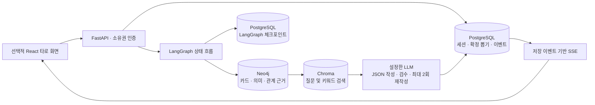

# Claude 개발 인계 — 타로 R0~R6 구현 후속 작업

2026-11-22 · 저장소: [explore-your-little-universe](https://github.com/ai-agent-orchestrator/explore-your-little-universe)

이 문서는 **구현을 마친 개발 브랜치를 이어받는 현재 인계서**다. 최초 제안서는 [CLAUDE_TAROT_IMPLEMENTATION.md](CLAUDE_TAROT_IMPLEMENTATION.md), 사용자가 제공한 실행 계획은 [TAROT_REFACTORING_PLAN.md](TAROT_REFACTORING_PLAN.md)다. 이미 끝난 R0~R6를 처음부터 다시 구현하지 않는다.

## Claude에게 그대로 전달할 요청

> `feat/tarot-refactor`의 타로 R0~R6 구현을 이어받아 코드 리뷰와 남은 검증을 진행해 주세요. 먼저 이 문서, `docs/TAROT_IMPLEMENTATION_STATUS.md`, `docs/TAROT_RUNBOOK.md`, 저장소의 적용 가능한 `AGENTS.md`를 읽고 작업 트리와 원격 상태를 확인하세요. 기존 사용자 변경을 보존하세요.
>
> 기존 600개 정적 Beta, 공개 스냅샷, Cypher import, “Hi, I'm Lumi.” 그림, Pages 워크플로와 `v1`을 유지하세요. 타로 모드는 별도 로컬 서버와 DB를 사용하는 선택 기능입니다. 실제 LLM 생성·검수는 아직 검증하지 않았습니다. 사용자가 제공한 로컬 LLM 설정이 있을 때만 실제 서비스 검증을 진행하고, 없으면 미검증으로 명시하세요. FakeLLM 성공을 실제 LLM 성공으로 보고하지 마세요.
>
> 아래 우선순위에 따라 문제를 재현하고 필요한 수정과 검증을 작은 커밋으로 남겨 주세요. 변경 이유, 실행한 검사, 건너뛴 검사와 남은 제약을 기록하세요. PR은 아래 의존 순서를 확인해 검토하고, 별도 병합 지시가 있기 전에는 현재 작업 브랜치에서 이어가세요.

## 브랜치와 PR

| 구분 | 기준 |
| --- | --- |
| 이전 공개 버전 | `v1` · `5d9f167de24d39bced50b38184598567304e545f` |
| 공개 정적 Beta | `main` · `95640790285012dfc51ec73286d2c096b3a64406` |
| 현재 개발 브랜치 | `feat/tarot-refactor` |
| R0~R6 코드 검증 기준 | `962e89699210df98b5a61bfaa3333b29ceeaaa80` |

인계 문서 커밋은 위 코드 검증 기준 이후에 추가된다. 최신 HEAD는 원격에서 확인한다. 문서가 추가됐다는 이유로 코드 검증을 새로 수행했다고 간주하지 않는다.

```powershell
git status --short
git fetch origin --prune
git switch feat/tarot-refactor
git log -5 --oneline
git diff main...HEAD --stat
```

로컬 브랜치가 없다면 `git switch --track origin/feat/tarot-refactor`를 사용한다. 기존 변경이나 원격과의 분기가 있으면 먼저 확인하고 강제 초기화하지 않는다.

PR은 단계별 **Draft**이며 뒤 단계의 base는 바로 앞 단계다. 전체 변경 검토에는 `main...feat/tarot-refactor` 비교를 사용한다. 승인 후 병합할 때는 R0부터 순서대로 진행하고, 각 단계 뒤 다음 PR의 base와 diff를 다시 확인한다.

| 단계 | 브랜치 | PR | 현재 base |
| --- | --- | --- | --- |
| R0 공유 코어 | `refactor/r0-lumi-core` | [#3](https://github.com/ai-agent-orchestrator/explore-your-little-universe/pull/3) | `main` |
| R1 카드·스키마 | `feat/tarot-r1-catalog` | [#4](https://github.com/ai-agent-orchestrator/explore-your-little-universe/pull/4) | R0 |
| R2 PostgreSQL | `feat/tarot-r2-postgres` | [#5](https://github.com/ai-agent-orchestrator/explore-your-little-universe/pull/5) | R1 |
| R3 검색 | `feat/tarot-r3-retrieval` | [#6](https://github.com/ai-agent-orchestrator/explore-your-little-universe/pull/6) | R2 |
| R4 LangGraph | `feat/tarot-r4-workflow` | [#7](https://github.com/ai-agent-orchestrator/explore-your-little-universe/pull/7) | R3 |
| R5 API·SSE | `feat/tarot-r5-api` | [#8](https://github.com/ai-agent-orchestrator/explore-your-little-universe/pull/8) | R4 |
| R6 화면·통합·문서 | `feat/tarot-refactor` | [#9](https://github.com/ai-agent-orchestrator/explore-your-little-universe/pull/9) | R5 |

## 구현된 데이터 흐름과 코드 위치



Neo4j와 Chroma의 조회 결과는 LangGraph 상태로 모인다. 위 화살표는 처리 순서이며 DB 간 직접 통신을 뜻하지 않는다. 임베딩은 기존 LiteRT 엔진으로 직접 계산하고 Chroma의 자동 임베딩 함수는 사용하지 않는다.

| 위치 | 역할 |
| --- | --- |
| `lumi_core/` | 공통 MBTI·별자리·타로 카탈로그, 기존 코퍼스, 설정, 그래프 시드, LiteRT 엔진 |
| `lumi_core/tests/golden/beta.json` | R0 이전 정적 Beta의 보존 기준 해시 |
| `tarot_lab/fixtures/meanings_v1.py` | 독립 작성 타로 해설과 방향별 근거 |
| `tarot_lab/schemas.py` | 입력·출력 계약 |
| `tarot_lab/repositories/` | PostgreSQL, Neo4j, Chroma 접근 |
| `tarot_lab/migrations/`, `migrate.py` | 서비스 스키마와 마이그레이션 |
| `tarot_lab/workflow/` | 상태, 검색, 작성, 검수, 조건부 재작성 |
| `tarot_lab/llm.py`, `runtime.py` | 명시적 LLM 설정, 실제 리소스 연결과 수명 관리 |
| `tarot_lab/api.py` | 생성·조회·재개·SSE·카드·health API |
| `frontend/src/` | 기존 정적 화면 셸과 lazy 타로 모드 |
| `tools/seed_tarot_knowledge.py` | Neo4j·Chroma 반복 적재 |
| `tools/evaluate_tarot_retrieval.py` | 고정 30문항 카드·방향 커버리지 검사 |

현재 수량은 **78장, 정/역 156개 의미, 타로 해설 180개**다. 156개 일반 해설과 탑·별·은둔자의 상황별 24개를 포함한다. 기존 600개와 합쳐 **Chroma 780개**다. 모든 카드의 모든 상황에 대해 장문 해설을 완성했다는 뜻은 아니다. 조합 수 계산도 독립 작성 글의 개수나 품질 성과로 표현하지 않는다.

## 반드시 유지할 계약

- 의존 방향은 실습 앱 → `lumi_core`다. 코어가 실습 앱을 다시 import하지 않는다. 기존 공개 import와 CLI는 호환 shim을 유지한다.
- 기존 600개 코퍼스 직렬화, 16유형 응답, 정적 `graph.json`, 공개 Cypher import, `docs/images/lumi.svg`, `.github/workflows/deploy-playground.yml`은 골든 검사 기준을 유지한다. 타로 데이터는 기존 정적 스냅샷에 합치지 않는다.
- Neo4j는 `mbti-zodiac` 범위에서 제한된 매개변수 쿼리를 사용한다. 타로 청크의 벡터는 Chroma에만 두며 기존 Neo4j 벡터 600개는 유지한다. Chroma 컬렉션은 프로필과 cosine 설정을 검사한다.
- 서버가 중복 없는 3장·방향·위치를 PostgreSQL 한 트랜잭션으로 확정한다. 프런트 클릭은 공개 순서만 정한다. 클라이언트의 카드 지정은 받지 않는다.
- 최초 발급 토큰 원문은 한 번만 반환하고 DB에는 해시만 보관한다. 소유권 토큰은 Authorization 헤더로 전달하며 URL에 넣지 않는다. 무권한 조회는 404다.
- 같은 토큰·키·입력은 같은 세션, 같은 토큰·키·다른 입력은 409다. **최초 응답 유실로 토큰을 받지 못했을 때** 같은 bootstrap 키로 중복 생성하지 않고 `409 session_token_required`를 반환한다. 원문 토큰을 복원하지 않는다. 자동 새 뽑기를 추가하지 않는다.
- 동일 세션 동시 실행은 advisory transaction lock으로 차단한다. SSE는 저장 이벤트 ID와 `Last-Event-ID`로 재생한다. 재개는 기존 카드와 체크포인트를 사용한다.
- 선택 카드·방향의 근거가 없으면 `needs_evidence`로 종료한다. 검수는 인용·카드·방향·위치·분량 등을 코드로 확인하고 LLM 검수는 보조로 쓴다. 재작성은 최대 2회다.
- LLM은 `LUMI_LLM_BASE_URL`, `LUMI_LLM_MODEL`, `LUMI_LLM_API_KEY`를 명시적으로 설정한다. 미설정을 다른 키나 FakeLLM 성공으로 대체하지 않는다.
- `VITE_TAROT_API_URL` 미설정 빌드에는 타로 탭과 타로 청크가 없다. 설정 시 별도 lazy 청크로 로드한다. GitHub Pages는 타로 API나 DB를 실행하지 않는다.
- 질문·카드·결과·이벤트·체크포인트는 PostgreSQL에 남는다. 브라우저는 접근 토큰과 입력 등을 sessionStorage에 보관한다. 새 세션 버튼은 서버 이력 삭제가 아니다. 삭제 시 서비스 행과 체크포인트를 모두 정리한다.

## 검증한 범위와 남은 범위

구현 기준 커밋에서 **Python 35개(실제 저장소 통합 7개 포함), 프런트 13개**가 통과했다. 기존 HTTP 16유형, 기존 검색 10문항, 타로 검색 30문항, 플래그 유무에 따른 프런트 빌드도 확인했다. 상세 기록은 [구현 상태](TAROT_IMPLEMENTATION_STATUS.md)와 [검색 결과 JSON](TAROT_RETRIEVAL_CHECKS.json)을 참고한다.

실제 PostgreSQL·Neo4j·Chroma·LiteRT와 PostgreSQL 체크포인터를 사용해 중복 생성 동시 요청, 롤백, 재적재, 방향 필터, 생성 예외 후 연결을 새로 만든 재개, API와 SSE 재생을 시험했다. 브라우저에서 카드 공개·역방향·출처와 새로고침 복구를 확인했다.

**작성·검수 모델은 FakeLLM만 사용했다.** 실제 외부 LLM 호환성, 품질과 비용은 미검증이다. 검색 30문항은 카드·방향 필터의 커버리지 검사이며 사람의 관련성 평가가 아니다. Docker 실행, 실제 모바일 기기 성능, 운영 부하와 장기 보관 정책도 미검증이다. 검증 PC는 Docker 대신 공식 EDB PostgreSQL 17.12 로컬 바이너리를 사용했다.

후속 작업은 아래 순서로 진행한다. 항목은 검토·검증 대상이며 현재 결함이 확인됐다는 뜻은 아니다.

1. **실제 LLM 연결·평가:** 설정된 제공자의 JSON 응답·인용 ID·1200~2000자·정역방향·한글 출력을 확인한다. 타임아웃·잘못된 JSON·검수 소진·재개를 확인하고 실행 모델, 입력, 결과와 비용을 별도 기록한다. 키가 없으면 단위·통합 검토부터 진행한다.
2. **코드 리뷰와 장애 시나리오:** 긴 LLM 호출 중 잠금·풀 사용, 프로세스 종료 후 재개, SSE 중단·재연결·중복 이벤트, 최초 생성 응답 유실 UX를 검토한다. 변경이 필요한 경우 재현 검사를 먼저 남긴다.
3. **실행 환경 검증:** Docker compose 신규 환경에서 마이그레이션·반복 적재·재시작을 확인하고, 실제 모바일에서 뒤집기·reduced-motion·접근성과 세션 복구를 확인한다.
4. **콘텐츠·검색 품질:** 카드·방향별 관련성 평가와 문체 검토를 추가한다. 부족한 상황 해설은 출처와 작성 기준을 명시해 확장한다. 기존 글 복제·방향명 치환만으로 수량을 부풀리지 않는다.
5. **운영 범위 결정:** 공개 운영 전 인증·요청 제한·보관 기간·삭제와 복구 방식을 설계한다. 현재 로컬 실험 기능을 운영 준비 완료로 표시하지 않는다.

## 설치·실행·검사

전체 설정은 [TAROT_RUNBOOK.md](TAROT_RUNBOOK.md)가 기준이다. `.env.tarot`, `.env.mbti`, 모델·DB·Chroma 디렉터리는 로컬 파일이며 커밋하지 않는다. DSN과 제공자 키는 문서에 복사하지 않는다.

```powershell
# 저장소 루트, Python 3.12 / Node.js 22.12 이상
.venv/Scripts/python -m pip install -r requirements-tarot.txt
# RUNBOOK에 따라 로컬 환경 파일과 Neo4j를 준비한 뒤 실행
docker compose --env-file .env.tarot -f tarot_lab/compose.yaml up -d
.venv/Scripts/python -m tarot_lab.migrate
.venv/Scripts/python -m tools.seed_tarot_knowledge --dataset tarot-v1 --neo4j --chroma
.venv/Scripts/python -m uvicorn tarot_lab.api:app --host 127.0.0.1 --port 8017
```

다른 터미널에서:

```powershell
cd frontend
npm ci
$env:VITE_TAROT_API_URL='http://127.0.0.1:8017'
npm run dev -- --port 5173 --strictPort
```

`http://127.0.0.1:5173/#tarot`를 사용한다. CORS는 해당 origin을 허용한다. `GET /api/health`에서 리소스별 상태를 확인한다. `llm=ok`는 설정·클라이언트 준비 상태이며 실제 유료 호출 성공을 보장하지 않는다. 기존 MBTI HTTP 검사는 8017을 사용하므로 실행 전에 타로 API를 잠시 종료한다.

```powershell
# 저장소 루트: DB 없이 가능한 검사
.venv/Scripts/python -m unittest discover -s mbti_lab -p "test_*.py"
.venv/Scripts/python -m unittest discover -s lumi_core -p "test_*.py"
.venv/Scripts/python -m unittest discover -s tarot_lab -p "test_*.py"
.venv/Scripts/python -m mbti_lab.verify_http
# 실제 세 DB·임베딩 모델·지식 적재 준비 후에만
$env:LUMI_INTEGRATION='1'
.venv/Scripts/python -m unittest discover -s tarot_lab -p "test_*.py"
.venv/Scripts/python tools/verify_corpus_retrieval.py
.venv/Scripts/python tools/evaluate_tarot_retrieval.py
```

통합 테스트의 실제 생성·검수는 계속 FakeLLM이며 설정된 제공자 키를 사용하지 않는다. 실제 LLM 평가는 별도로 실행·기록한다.

```powershell
# frontend 디렉터리에서
npm test
Remove-Item Env:VITE_TAROT_API_URL -ErrorAction SilentlyContinue
npm run build
# 정적 빌드에 타로 청크가 없는지 확인한 뒤 선택 모드 빌드
$env:VITE_TAROT_API_URL='http://127.0.0.1:8017'
npm run build
```

완료 보고에는 수정 커밋, 실제 실행한 검사, 외부 LLM 평가 여부, 남은 항목을 구분해 적는다. R0~R6의 과거 검사 결과를 새 환경에서 다시 실행한 결과로 보고하지 않는다.
