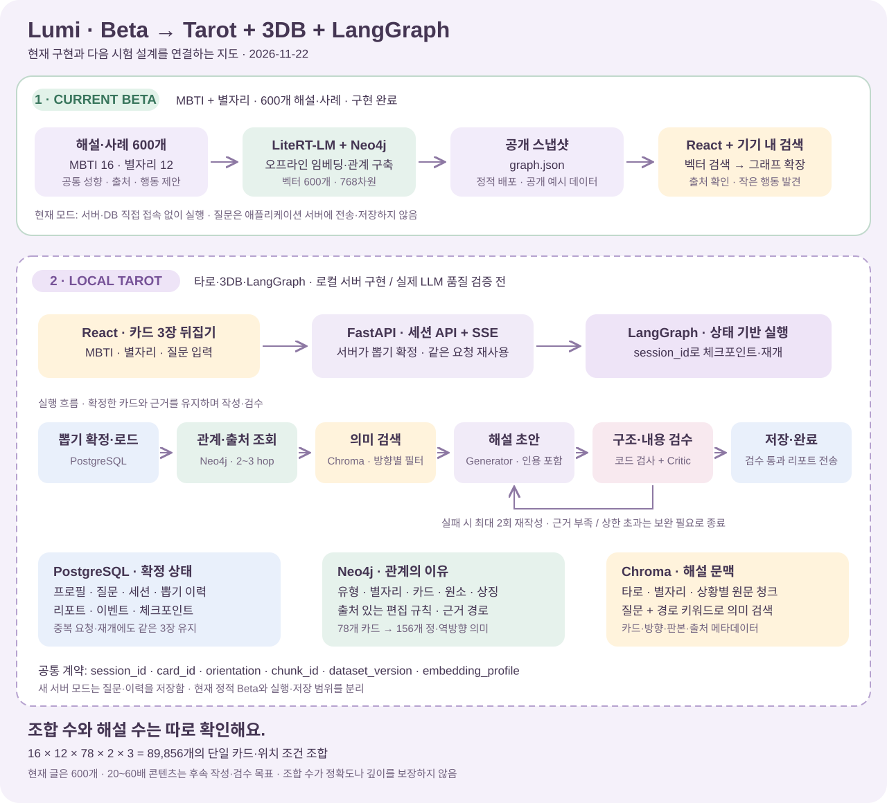
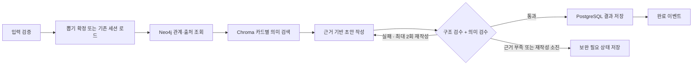

# Lumi Beta 이후: 타로 × 3DB × LangGraph 1차 시험 설계

2026-11-22 · **설계 문서 — 타로·PostgreSQL·Chroma·LangGraph 런타임은 아직 미구현**

현재 구현은 [600개 해설·사례 기반 정적 GraphRAG Beta](INTERPRETATION_CORPUS.md)다. 이 설계는 MBTI·별자리·공통 성향·출처 ID와 루미 캐릭터를 이어받아 별도 서버 모드로 확장한다. 기존 정적 페이지의 브라우저 검색은 계속 독립적으로 실행한다.



## 1. 목적과 저장소별 책임

**PostgreSQL은 확정한 세션 상태, Neo4j는 관계의 이유, Chroma는 해설 원문 검색, LangGraph는 단계별 실행과 재개**를 담당한다.

| 구성 요소 | 데이터·책임 | 1차 시험에서 확인할 것 |
| --- | --- | --- |
| PostgreSQL | 프로필 스냅샷, 질문, 뽑기 세션, 카드·방향·위치, 실행 상태, 최종 리포트, 체크포인트 | 같은 요청의 재전송·재개에서 카드가 바뀌지 않는가 |
| Neo4j | 기존 MBTI·별자리·성향, 카드·해석 상태·원소·상징·편집 규칙·출처 | 선택한 카드에서 시작한 2~3홉 경로가 해설 근거에 실제로 연결되는가 |
| Chroma | 출처·판본이 붙은 기존 600개 글과 타로 해설 청크의 임베딩 | 뽑힌 카드·정역방향을 지키면서 질문과 가까운 문맥을 찾는가 |
| LangGraph | 입력 검증 → 확정 뽑기 → 관계 조회 → 의미 검색 → 작성 → 검수 → 저장·완료 | 중단·부족 근거·검수 실패를 정해진 분기로 처리하는가 |
| React + FastAPI | 셔플·뒤집기 연출, 세션 생성·조회, 진행 이벤트·완성 리포트 표시 | 화면과 서버의 카드·정역방향·상태가 일치하는가 |

현재 Beta는 Neo4j에 벡터도 저장하고 브라우저에서 공개 스냅샷을 검색한다. 새 모드에서는 Chroma가 온라인 의미 검색을 맡는다. 두 모드의 결과·성능·저장 범위를 화면과 문서에서 구분한다.

## 2. 카드 모델: 78장과 156개 해석 상태

`TarotCard`는 78개의 카드 원본이다. 카드의 정·역방향을 공유 카드 노드의 `is_reversed` 값으로 바꿔 쓰면 서로 다른 세션이 충돌하므로, 방향은 별도 `TarotMeaning` 노드로 만든다.

```text
TarotCard (78) ──HAS_MEANING──▶ TarotMeaning (156)
  card_id                        meaning_id = card_id + ':' + orientation
  arcana, suit, rank             orientation = upright | reversed

ReadingSession ── PostgreSQL에 3개의 Draw 저장
  draw = card_id + orientation + position + ordinal
```

메이저 아르카나 22장과 마이너 아르카나 56장을 기본 목록으로 삼는다. 마이너의 원소 대응은 `wands/fire`, `cups/water`, `swords/air`, `pentacles/earth`라는 실습 규칙으로 버전을 붙인다. 메이저 카드의 원소나 점성술 대응은 유파에 따라 달라질 수 있으므로, 선택한 출처·체계를 명시한 항목만 넣고 나머지는 미정으로 둔다. [기본 카드 목록 참고](https://www.learntarot.com/cards.htm)

기존 `HAS_TRAIT`와 `DESCRIBED_BY` 관계는 유지한다. `COMPATIBLE_WITH`를 검증된 궁합처럼 도입하지 않는다. 원소 일치·차이는 편집된 상징 해석의 단서이며 MBTI의 주기능·열등기능이나 실제 사람의 심리에 미치는 인과로 단정하지 않는다. 인지기능을 추가하는 단계는 별도 출처·모델 판본을 합의한 뒤로 미룬다.

## 3. Neo4j 모델과 근거 경로

```text
(MbtiType)-[:HAS_TRAIT]->(SharedTrait)<-[:HAS_TRAIT]-(ZodiacSign)
(ZodiacSign)-[:ASSOCIATED_WITH]->(Element)
(TarotCard)-[:HAS_MEANING]->(TarotMeaning)
(TarotCard)-[:ASSOCIATED_WITH]->(Element)
(TarotMeaning)-[:SYMBOLIZES]->(Archetype)
(TarotMeaning)-[:HAS_RULE]->(InterpretationRule)-[:RELATES_TO]->(SharedTrait)
(InterpretationRule)-[:FROM_SOURCE]->(InterpretationSource)
(TarotMeaning)-[:DESCRIBED_BY]->(RagChunk)-[:FROM_DOCUMENT]->(RagDocument)
```

`InterpretationRule`에는 `effect=amplifies|contrasts|balances`, `dataset_version`, `mapping_version`, `source_id`, `editorial_note`를 둔다. 규칙을 중간 노드로 두면 연결 이유와 출처를 독립적으로 반환할 수 있다. 기존의 단순 `AMPLIFIES`·`CONFLICTS` 아이디어를 출처 추적이 가능한 구조로 표현한 것이다.

예를 들어 **INTJ + 물병자리 + 탑 역방향**이면 해당 의미 노드 → 편집 규칙 → 공통 성향과 별자리 → 원소 경로를 찾아 원문 검색에 쓸 키워드를 반환한다. “예기치 못한 변화” 같은 키워드가 실제 데이터에 있을 때만 사용하며, 예시 문구를 조회 결과처럼 하드코딩하지 않는다.

조회는 고정된 읽기 전용 Cypher 템플릿과 파라미터를 사용한다. 홉 수는 2~3, 반환 경로는 최대 30개, 키워드는 최대 12개로 시작한다. 출처·판본이 없거나 매핑이 비어 있으면 `insufficient_graph_context`를 반환한다. 임의 길이 경로 확장과 LLM의 Cypher 직접 실행은 1차 범위에서 제외한다.

## 4. PostgreSQL 최소 데이터 계약

| 테이블 | 주요 열·제약 |
| --- | --- |
| `profiles` | `profile_id`, `mbti`, `zodiac_id`, `created_at`; 프로필은 선택 사항 |
| `reading_sessions` | `session_id`, 선택적 `profile_id`, 세션 시점의 `mbti`·`zodiac_id`, `question`, `request_hash`, 클라이언트 범위의 고유 `idempotency_key`, `dataset_version`, `mapping_version`, `embedding_profile`, `status`, `created_at` |
| `reading_draws` | `session_id`, `ordinal` 0~2, `position` past/present/future, `card_id`, `orientation`; `UNIQUE(session_id,card_id)`, `UNIQUE(session_id,ordinal)`, `UNIQUE(session_id,position)` |
| `reading_reports` | `session_id` 고유, `report`, `evidence_ids`, `validation`, `model_id`, `prompt_version`, `completed_at` |
| `reading_events` | `session_id`, `sequence`, `event_type`, `payload`, `created_at`; 세션 내 sequence 고유 |
| 체크포인터 전용 테이블 | 선택한 PostgreSQL checkpointer가 관리; 서비스 테이블과 역할·네임스페이스 분리 |

세션과 3장 뽑기를 하나의 트랜잭션으로 확정한다. 같은 키·같은 입력이면 기존 세션을 반환하고, 같은 키·다른 입력이면 `409 Conflict`다. 질문·뽑기·버전을 체크포인트에 재현할 수 있어야 한다. 재개 시 이미 확정한 카드를 다시 뽑지 않는다.

서로 다른 DB를 하나의 분산 트랜잭션으로 묶지 않는다. 확정된 세션을 PostgreSQL에 먼저 저장한 뒤 Neo4j·Chroma는 판본을 고정해 읽는다. 실패하면 같은 세션을 재개한다. 최소 실험에서는 세션 생성 후 지식 저장소를 쓰지 않는다.

## 5. Chroma 청크와 해설 분량

청크의 메타데이터 계약:

```text
chunk_id, document_id, dataset_version, embedding_profile,
source_url, source_kind, reviewed_on, content_hash,
card_id, orientation, position, topic, facet, locale
```

기존 MBTI·별자리 글은 카드 필드를 비워 두고 `source_kind`로 구분한다. 카드별 검색은 **각 카드·방향에 맞는 메타데이터 필터**를 걸어 별도로 수행한 뒤 결과를 합친다. 질문에 그래프 키워드를 더한 확장 검색과 원래 질문 검색을 비교해 키워드가 질문을 덮어쓰는지 점검한다. 방향과 관계없는 일반 글은 별도 일반 근거 슬롯에만 넣는다. [Chroma 메타데이터 필터](https://docs.trychroma.com/docs/querying-collections/metadata-filtering)

`16 × 12 × 78 × 2 × 3 = 89,856`은 **한 카드가 한 위치에 놓이는 조건 조합**이다. 서로 다른 3장 전체의 조합 수나 실제 작성된 해설 수가 아니다. 중복 문장을 조합 수만큼 복제하지 않는다.

| 단계 | 실제 작성·검수할 타로 청크 목표 | 기존 600개 포함 총량 |
| --- | ---: | ---: |
| 연결 시험 | 156개 의미 × 5개 주제 = 780 | 1,380개, 현재의 2.3배 |
| 분량 확장 목표 | 156 × 3개 위치 × 5개 주제 × 6개 관점 = 14,040 | 14,640개, 현재의 24.4배 |
| 후속 확장 상한 예시 | 156 × 3 × 5 × 15 = 35,100 | 35,700개, 현재의 59.5배 |

주제는 일반·관계·일/학업·돈에 관한 감정과 선택·자기 성찰의 다섯 가지다. 관점은 상징, 장점, 주의점, 질문, 적용 사례, 작은 행동부터 시작한다. 위 수치는 목표 산식이며 현재 콘텐츠나 품질·깊이의 달성 실적이 아니다. 유사 청크를 단순 증식하지 않고 출처 확인·중복 검사·샘플 검수를 통과한 자료만 적재한다. 카드 그림은 직접 제작하거나 사용권을 확인한 것만 사용한다.

## 6. LangGraph 상태와 단계

상태에는 `session_id`, `question`, `mbti`, `zodiac_id`, `draws`, 데이터·매핑·임베딩 판본, `graph_paths`, `keywords`, `chunks`, `draft`, `validation_errors`, `rewrite_count`, `status`, `error_code`를 둔다. 원문과 경로 ID를 중간 단계부터 보존한다.



뽑기 확정은 생성 노드보다 먼저 실행한다. 재작성 루프에서는 카드·방향·위치·확정된 근거를 바꾸지 않는다. `rewrite_count < 2`일 때만 재작성하며, 최초 작성 포함 최대 3회다. LLM 재작성 예산과 DB 통신 재시도 횟수는 따로 관리한다.

검수는 두 층으로 나눈다. 결정적인 코드 검사는 세 카드 모두·정역방향·위치·유효 출처 ID·글 길이·빈 근거 여부를 확인한다. LLM 검수는 근거와 본문이 어긋나는지 보조 판단하되, 필수 검사를 통과시키는 권한은 주지 않는다. 초기 리포트는 한국어 공백 포함 1,200~2,000자를 목표로 하며, 근거가 부족하면 분량을 채우기보다 `needs_evidence`로 종료한다.

LangGraph 체크포인터의 `thread_id`는 애플리케이션 `session_id`에 대응시킨다. 실행 재개와 장기 프로필 저장은 다른 책임이다. [Persistence](https://docs.langchain.com/oss/python/langgraph/persistence), [Checkpointers](https://docs.langchain.com/oss/python/langgraph/checkpointers), [Graph API](https://docs.langchain.com/oss/python/langgraph/graph-api)

## 7. 화면과 API 계약

React의 셔플·3D 뒤집기는 연출이다. 화면이 임의 생성한 카드 배열을 최종 결과로 신뢰하지 않는다. 서버가 78장 중 **중복 없이 3장**을 뽑고 각 방향을 확정해 저장한 뒤, 프런트가 같은 결과를 순서대로 공개한다. past/present/future는 성찰을 위한 스프레드 위치 이름이며 미래 사건 예측의 검증을 뜻하지 않는다.

예정 API:

- `POST /api/readings`: MBTI·별자리·질문과 `Idempotency-Key`를 받아 세션·3장·상태를 반환.
- `GET /api/readings/{session_id}`: 확정 카드, 현재 실행 상태, 완성된 경우 리포트·출처 반환.
- `GET /api/readings/{session_id}/events`: 인증된 세션의 SSE 진행 이벤트를 전송. 이벤트 ID로 재연결 시 중복 처리.
- `POST /api/readings/{session_id}/resume`: 재개 가능한 오류에서 같은 카드와 버전으로 재실행. 최종 완료 세션은 새 뽑기 없이 기존 결과 반환.

공개 웹에 연결할 때는 세션 소유권을 확인한다. 1차 로컬 시험은 127.0.0.1에서만 실행한다. 질문 저장은 새 서버 모드에서 명시적으로 안내하고, 로그·체크포인트·리포트의 보관·삭제 범위를 함께 정한다. 기존 정적 Beta의 “질문을 서버에 보내거나 저장하지 않음”은 정적 모드에 계속 적용한다.

진행 이벤트는 `session.created`, `draw.confirmed`, `graph.completed`, `retrieval.completed`, `draft.validating`, `report.completed`, `report.needs_evidence`, `run.failed`를 사용한다. 검수 전 생성 토큰을 최종 결과로 표시하지 않는다. 1차는 단계 진행만 스트리밍하고 검수 통과 리포트를 완성 이벤트로 보낸다. [LangGraph 스트리밍](https://docs.langchain.com/oss/python/langgraph/streaming)

## 8. 구현 순서와 완료 기준

1. 카드 78개·방향 156개·공통 ID·스키마·판본을 정의하고 최소 fixture를 검증한다.
2. PostgreSQL의 세션·뽑기·중복 요청을 구현한다. 고정 seed는 테스트에만 쓰고 운영 뽑기는 서버 난수를 사용한다.
3. Neo4j의 출처가 있는 관계 조회와 Chroma의 카드·방향별 검색을 각각 통합 테스트한다.
4. 외부 LLM 없는 가짜 작성기·검수기로 LangGraph 정상·실패·재개 흐름을 검증한다.
5. 설정된 LLM 어댑터를 연결해 리포트·인용·재작성 상한을 검증한다.
6. React에서 카드 3장 뒤집기·진행·완성·오류·재연결을 연결한다. 기존 정적 페이지 회귀 검증을 수행한다.

완료 조건: 반복 실행해도 세션당 중복 없는 3장 유지, 재개해도 정역방향 유지, 카드별 근거 누락 탐지, DB 오류를 빈 검색 결과로 숨기지 않음, 유효한 청크·그래프 출처 인용, 재작성 상한 준수, 세 저장소 판본 일치, 기존 600개 검색과 “Hi, I'm Lumi.” 그림 보존.

실험 보고서는 벡터 단독 / 벡터+그래프 / 벡터+그래프+검수를 같은 고정 질문·카드 세트로 비교한다. 단계별 지연, 출처 누락, 방향 오류, 재작성 횟수, 수동 관련성 평가를 기록한다. “20~60배 더 정확함” 또는 “환각 없음” 같은 결론으로 환산하지 않는다.

Claude에게 전달할 실행 지시는 [CLAUDE_TAROT_IMPLEMENTATION.md](CLAUDE_TAROT_IMPLEMENTATION.md)에 정리했다.
