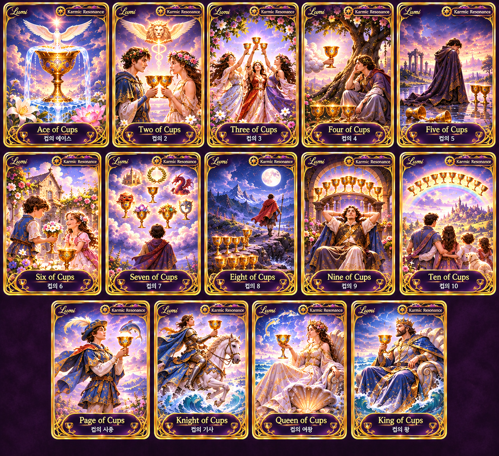

# Karmic Resonance · Cups · 컵 14장

[프로젝트 소개](../README.md) · [메이저 22장](TAROT_MAJOR_ARCANA_GALLERY.md) · [Wands · 완드](TAROT_WANDS_GALLERY.md) · [Swords · 소드](TAROT_SWORDS_GALLERY.md) · [Pentacles · 펜타클](TAROT_PENTACLES_GALLERY.md)

사용자가 ChatGPT에서 제작한 카드 이름 포함 14장 합본 원본이다. 개별 카드 이미지 14개로 분리한 상태는 아니며, 앱 연결 전 카드별 파일 분리와 도상·수트 개수 검수가 필요하다. 타로 서버 기능은 아직 설계 단계다.

| 카드 ID | 카드 이름 |
| --- | --- |
| `cups_01` | Ace of Cups |
| `cups_02` | Two of Cups |
| `cups_03` | Three of Cups |
| `cups_04` | Four of Cups |
| `cups_05` | Five of Cups |
| `cups_06` | Six of Cups |
| `cups_07` | Seven of Cups |
| `cups_08` | Eight of Cups |
| `cups_09` | Nine of Cups |
| `cups_10` | Ten of Cups |
| `cups_11` | Page of Cups |
| `cups_12` | Knight of Cups |
| `cups_13` | Queen of Cups |
| `cups_14` | King of Cups |

합본 배치: 첫째 줄 Ace~Five, 둘째 줄 Six~Ten, 셋째 줄 Page·Knight·Queen·King. 원본을 수정하지 않고 보관한다. 생성 아트이며 RWS 원본 스캔으로 표시하지 않는다.
