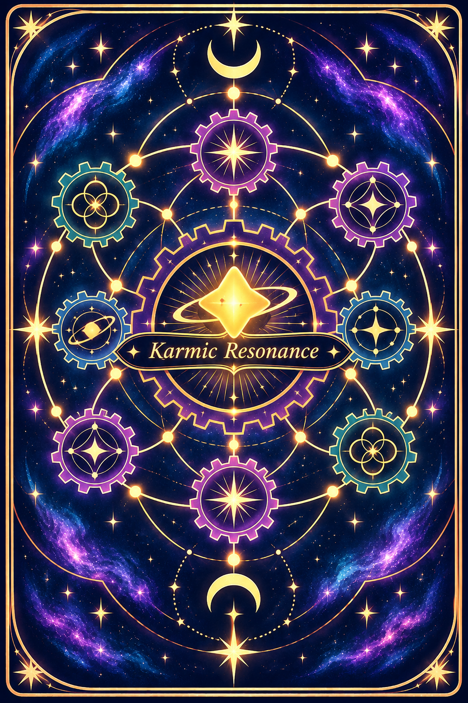

# Karmic Resonance · 메이저 아르카나 22장

[프로젝트 소개](../README.md) · [아트 프롬프트·인계](TAROT_ART_PROMPTS.md) · [카드 ID·파일 매핑](images/tarot/major-arcana.json)

사용자가 ChatGPT에서 제작한 Lumi·우주·금빛 톱니 시리즈. 중복 후보는 우측 상단의 톱니와 `karmic resonance` 문구를 기준으로 선택했다. 이 그림들은 RWS 도상을 재해석한 커스텀 아트이며 RWS 원본 스캔이 아니다.

**메이저 앞면 22장 + 공통 뒷면 1장 완료.** 카드 아트가 완성된 상태이며 타로 뽑기·3DB 서버 기능은 아직 설계 단계다. 마이너 56장은 수트별 합본으로 추가됐다: [Wands](TAROT_WANDS_GALLERY.md) · [Cups](TAROT_CUPS_GALLERY.md) · [Swords](TAROT_SWORDS_GALLERY.md) · [Pentacles](TAROT_PENTACLES_GALLERY.md). 개별 파일 분리·도상 검수는 남은 작업이다.

번호는 RWS 기준으로 Strength VIII, Justice XI를 사용한다. README 대표 전시 순서 Hermit → Tower → Star와 달리 아래는 0~21 전체 카탈로그 순서다.

<table>
  <tr>
    <td align="center" width="25%"></td>
    <td align="center" width="25%"></td>
    <td align="center" width="25%"></td>
    <td align="center" width="25%"></td>
  </tr>
  <tr>
    <td align="center" width="25%"></td>
    <td align="center" width="25%"></td>
    <td align="center" width="25%"></td>
    <td align="center" width="25%"></td>
  </tr>
  <tr>
    <td align="center" width="25%"></td>
    <td align="center" width="25%"></td>
    <td align="center" width="25%"></td>
    <td align="center" width="25%"></td>
  </tr>
  <tr>
    <td align="center" width="25%"></td>
    <td align="center" width="25%"></td>
    <td align="center" width="25%"></td>
    <td align="center" width="25%"></td>
  </tr>
  <tr>
    <td align="center" width="25%"></td>
    <td align="center" width="25%"></td>
    <td align="center" width="25%"></td>
    <td align="center" width="25%"></td>
  </tr>
  <tr>
    <td align="center" width="25%"></td>
    <td align="center" width="25%"></td>
  </tr>
</table>

## 공통 뒷면

원본 PNG는 수정 없이 보관한다. 정역방향은 같은 앞면을 회전해 표시하며, 전시용 SVG는 2:3 프레임 안에 금빛 이탤릭 제목을 표시한다. `node frontend/scripts/design-tarot.mjs`로 재생성한다. 앱에서 방향·위치를 제공한다. 뒷면 문구로 방향이 보이므로 뒷면 표시 방향은 고정하고 공개 시점에 앞면 방향을 적용한다.
