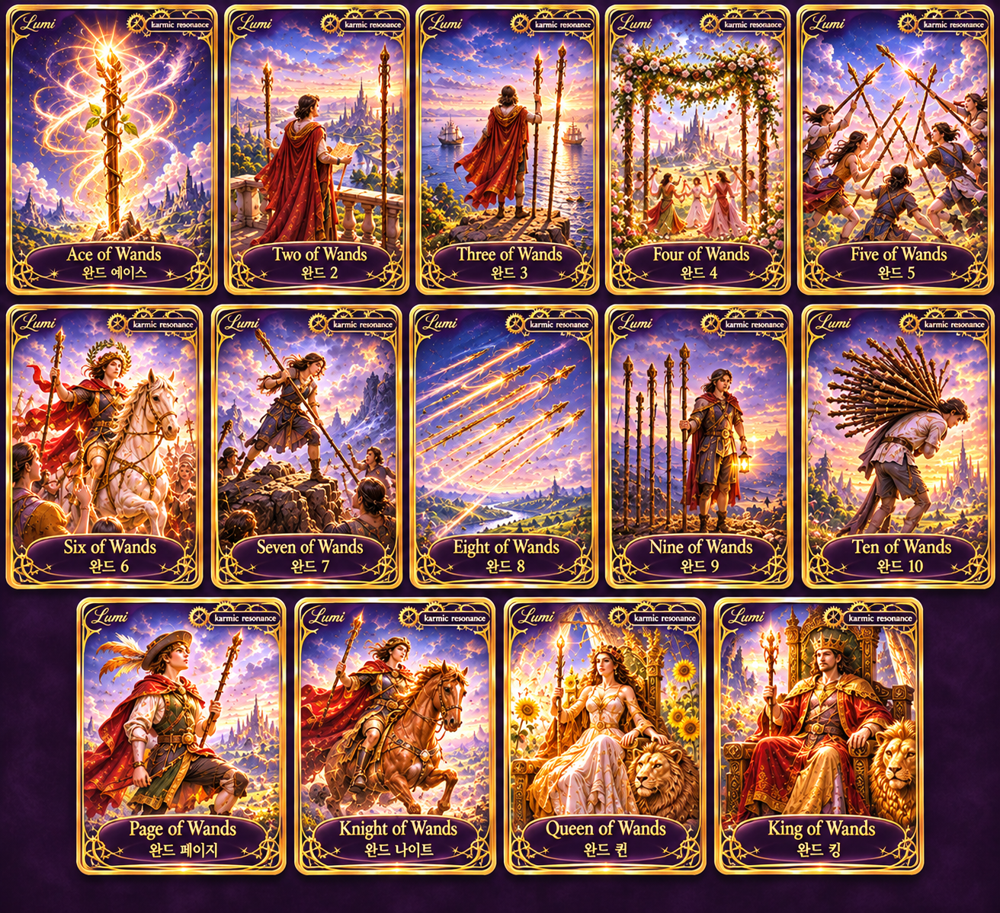

# Karmic Resonance · Wands · 완드 14장

[프로젝트 소개](../README.md) · [메이저 22장](TAROT_MAJOR_ARCANA_GALLERY.md) · [Cups · 컵](TAROT_CUPS_GALLERY.md) · [Swords · 소드](TAROT_SWORDS_GALLERY.md) · [Pentacles · 펜타클](TAROT_PENTACLES_GALLERY.md)

사용자가 ChatGPT에서 제작한 카드 이름 포함 14장 합본 원본이다. 개별 카드 이미지 14개로 분리한 상태는 아니며, 앱 연결 전 카드별 파일 분리와 도상·수트 개수 검수가 필요하다. 타로 서버 기능은 아직 설계 단계다.

| 카드 ID | 카드 이름 |
| --- | --- |
| `wands_01` | Ace of Wands |
| `wands_02` | Two of Wands |
| `wands_03` | Three of Wands |
| `wands_04` | Four of Wands |
| `wands_05` | Five of Wands |
| `wands_06` | Six of Wands |
| `wands_07` | Seven of Wands |
| `wands_08` | Eight of Wands |
| `wands_09` | Nine of Wands |
| `wands_10` | Ten of Wands |
| `wands_11` | Page of Wands |
| `wands_12` | Knight of Wands |
| `wands_13` | Queen of Wands |
| `wands_14` | King of Wands |

합본 배치: 첫째 줄 Ace~Five, 둘째 줄 Six~Ten, 셋째 줄 Page·Knight·Queen·King. 원본을 수정하지 않고 보관한다. 생성 아트이며 RWS 원본 스캔으로 표시하지 않는다.
